# Manual de meshbox

meshbox convierte una Raspberry Pi y un nodo Meshtastic en el mapa en vivo de la red de una zona: nodos, enlaces, mensajes del canal público, alertas y estadísticas, con un panel de administración en la red local y, si se quiere, publicado en internet sin abrir puertos del router.

Este manual sigue el camino completo de una instalación nueva, desde la tarjeta de memoria vacía hasta el uso diario. Las capturas son de una red simulada: los nodos, los nombres y los mensajes son inventados.

Versión del manual: meshbox 0.8.3. Versión en PDF para descargar o imprimir: [`manual.pdf`](manual.pdf).

## Índice

1. [Qué es meshbox](#1-qué-es-meshbox)
2. [Lo que hace falta](#2-lo-que-hace-falta)
3. [Preparar la Raspberry Pi](#3-preparar-la-raspberry-pi)
4. [Instalar meshbox](#4-instalar-meshbox)
5. [Asistente de configuración](#5-asistente-de-configuración)
6. [Conectar la radio](#6-conectar-la-radio)
7. [Sitio público](#7-sitio-público)
8. [Panel de administración](#8-panel-de-administración)
9. [Publicar en internet](#9-publicar-en-internet)
10. [Mantenimiento](#10-mantenimiento)
11. [Problemas frecuentes](#11-problemas-frecuentes)
12. [Glosario](#12-glosario)

## 1. Qué es meshbox

Un nodo Meshtastic escucha por radio todo lo que circula en la red de la zona. meshbox recibe esos paquetes desde el nodo, los decodifica, aplica las reglas de privacidad, los guarda en la Raspberry Pi y los publica en dos lugares:

| Parte | Quién la usa | Para qué |
|---|---|---|
| Sitio público | Cualquier persona, en la red local o en internet | Ver el mapa en vivo, los nodos, el chat del canal público, las alertas y las estadísticas. Se instala en el celular como aplicación. |
| Panel de administración | Quien administra el equipo, desde la red local | Configurar la radio, el broker MQTT, los canales, la privacidad, los usuarios, los respaldos, las actualizaciones y la placa conectada. |

Todo corre en la Pi, que puede ser una Zero 2 W de 512 MB. Trae su propio servidor MQTT (Mosquitto), el mapa base de la zona guardado en el equipo y la publicación en internet con un túnel de Cloudflare. El sitio público no muestra mensajes directos ni de canales privados; los de la placa conectada quedan en la Pi y solo se ven en el panel.

## 2. Lo que hace falta

| Elemento | Detalle |
|---|---|
| Raspberry Pi | Zero 2 W, 3, 4, 5 o 400/500, con Raspberry Pi OS Lite de 64 bits (Debian 12 o 13). La Zero, Zero W, Pi 1 y Pi 2 no sirven: solo corren sistemas de 32 bits. |
| Tarjeta microSD | 16 GB o más. |
| Fuente | La recomendada para cada modelo (5 V, 2,5 A para la Zero 2 W). |
| Nodo Meshtastic | Probado con Heltec V3 y V4. Otros nodos Meshtastic deberían funcionar igual, por USB o por MQTT. |
| Cable USB de datos | Si el nodo va enchufado a la Pi. Algunos cables solo cargan y no pasan datos. |
| Conexión a internet | Para instalar, descargar el mapa base y publicar el sitio. Después el sitio funciona también en la red local sin internet. |
| Dominio en Cloudflare | Opcional, solo para publicar el sitio en internet con una dirección propia. |

## 3. Preparar la Raspberry Pi

### 3.1 Grabar la tarjeta

1. Descargar e instalar [Raspberry Pi Imager](https://www.raspberrypi.com/software/) en la computadora.
2. Elegir el modelo de Raspberry Pi y, como sistema operativo, **Raspberry Pi OS (other) → Raspberry Pi OS Lite (64-bit)**.
3. Elegir la tarjeta y, cuando Imager ofrece personalizar el sistema, completar:
   - **Nombre del equipo**, por ejemplo `meshbox`.
   - **Usuario y contraseña** para entrar por SSH.
   - **Red WiFi**: nombre, contraseña y país.
   - **Zona horaria** y distribución del teclado.
   - En la pestaña **Servicios**, activar **SSH** con contraseña.
4. Grabar, poner la tarjeta en la Pi y encenderla. El primer arranque tarda unos minutos.

### 3.2 Entrar por SSH

Desde la computadora, en la misma red WiFi, abrir una terminal (en Windows: PowerShell o Terminal) y escribir:

```bash
ssh usuario@meshbox.local
```

`usuario` es el que se eligió en Imager y `meshbox` el nombre del equipo. Si `.local` no responde, usar la IP de la Pi, que figura en la lista de dispositivos del router:

```bash
ssh usuario@192.168.0.10
```

La primera vez pregunta si se confía en el equipo: responder `yes` y después escribir la contraseña.

## 4. Instalar meshbox

### 4.1 El comando

Ya dentro de la Pi por SSH, un solo comando baja la última versión publicada, verifica su firma y la instala:

```bash
curl -fsSL https://raw.githubusercontent.com/marcomagnaiot/meshbox/main/deploy/get.sh | sudo bash
```

Pide la contraseña del usuario (la de `sudo`). En una Pi Zero 2 W tarda varios minutos: instala paquetes del sistema, Mosquitto y las dependencias de Python.

### 4.2 Equipo dedicado o compartido

El comando anterior instala en modo **equipo dedicado**, pensado para una Pi que solo hace de meshbox. Si la Pi ya corre otros servicios (Home Assistant, Pi-hole, un servidor web), conviene el modo **compartido**, que no toca lo que ya está:

```bash
curl -fsSL https://raw.githubusercontent.com/marcomagnaiot/meshbox/main/deploy/get.sh | sudo bash -s -- --shared
```

| Aspecto | Equipo dedicado | Equipo compartido |
|---|---|---|
| Dirección del sitio y del panel | `http://meshbox.local` (puerto 80) | `http://<nombre>.local:8090` |
| Nombre del equipo | Pasa a ser `meshbox` | No se toca |
| WiFi y punto de acceso | Se administran desde el panel | Solo se muestran |
| Registros del sistema | El instalador fija su tamaño | No se tocan |

### 4.3 Al terminar

El instalador termina con un mensaje como este:

```
meshbox 0.8.3 instalado (modo appliance).

  Siguiente paso: entrá a http://192.168.0.10/setup y usá el código ABCD1234
  (o http://meshbox.local/setup). El asistente queda abierto 60 minutos; si se
  vence, se vuelve a abrir con: sudo systemctl restart meshbox

  Sitio público: http://192.168.0.10   Panel: http://192.168.0.10/admin
  Registros: journalctl -u meshbox -f
```

El **código de configuración** es de un solo uso y se pide hasta crear el primer usuario. Conviene copiarlo antes de cerrar la terminal; si se pierde, se puede volver a ver con:

```bash
sudo grep setup_code /etc/meshbox/secrets.toml
```

Mientras no haya ningún usuario, el sitio en la red local avisa que falta configurar y tiene un botón que lleva al asistente:

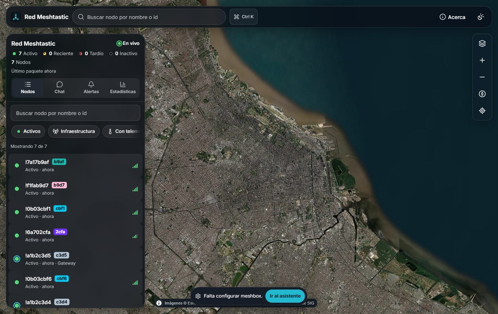

## 5. Asistente de configuración

El asistente está en `http://<dirección de la Pi>/setup`. Son diez pasos; la columna de la izquierda marca los que ya están hechos y se puede volver atrás en cualquier momento.

### 5.1 Código

Escribir el código que mostró el instalador.

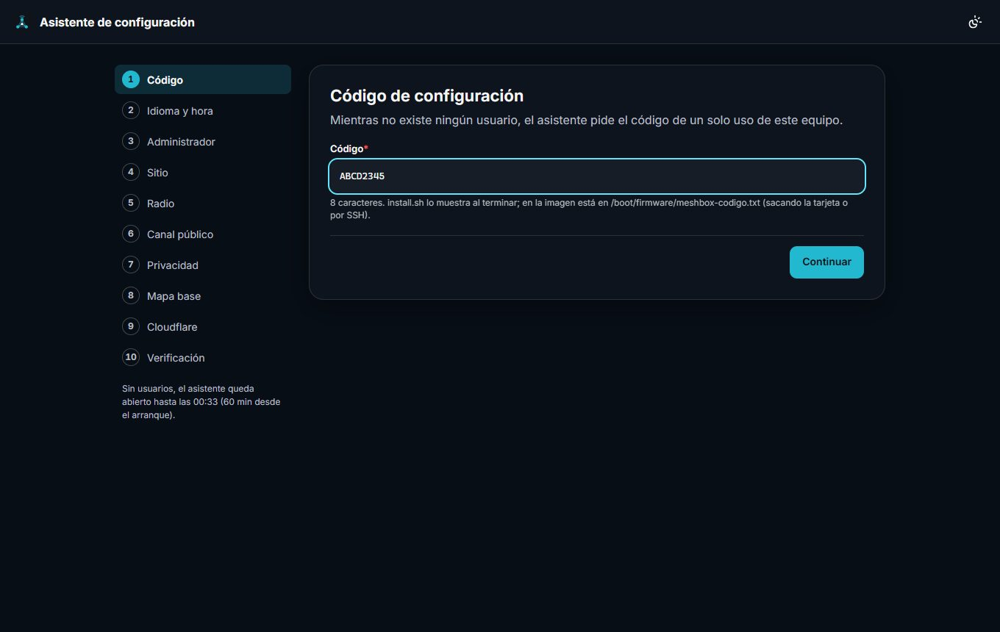

### 5.2 Idioma y zona horaria

El idioma por defecto del sitio público (cada visitante puede cambiarlo) y la zona horaria de las fechas y los gráficos.

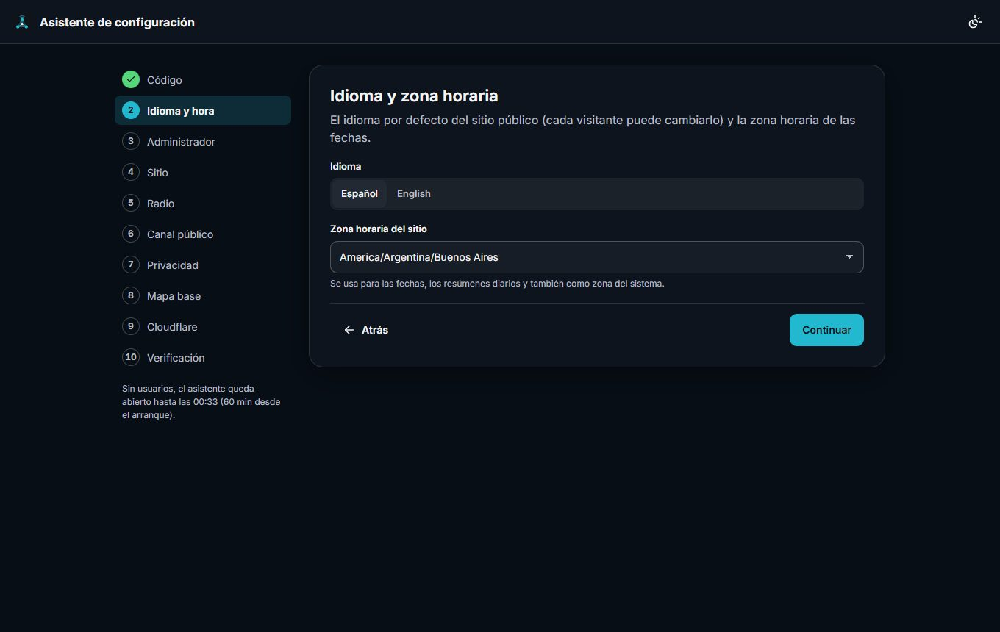

### 5.3 Cuenta de administración

No hay contraseña por defecto: esta cuenta es la que entra al panel. La contraseña necesita al menos 8 caracteres y no puede contener el usuario. Una frase larga es más segura y más fácil de recordar que una palabra con símbolos. Después se pueden crear más usuarios, por ejemplo operadores con menos permisos.

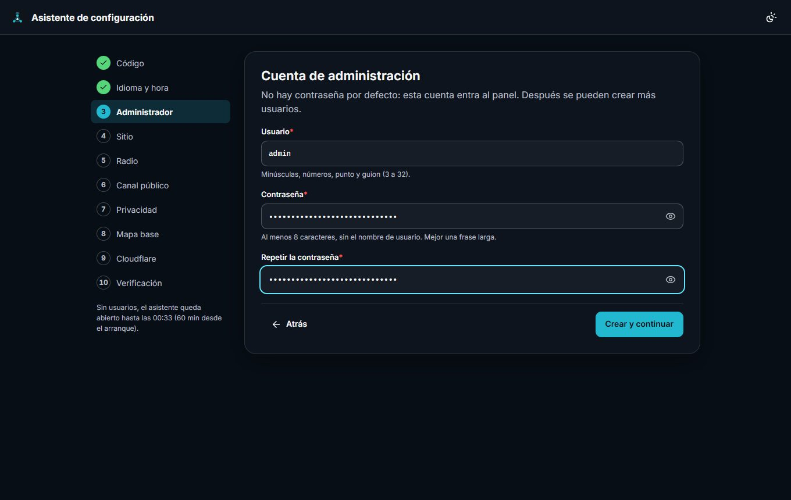

### 5.4 Sitio

- **Nombre** y **descripción**: los que se ven en el sitio público y al compartir el enlace.
- **Identificador corto**: minúsculas, números y guiones. Arma la raíz de los tópicos MQTT (`msh/AR/<identificador>`).
- **Centro y zoom del mapa**: hay tres formas de elegirlos.
  - Escribir la ciudad en el buscador y elegir el resultado. El mapa va hasta ahí y toma el centro y el zoom.
  - Mover el mapa y tocar **Usar el centro y el zoom de la vista**.
  - Pegar las coordenadas en los campos de latitud y longitud. Se puede pegar de una vez lo que copia Google Maps (`-40.81345, -62.99668`), un enlace de Google Maps o grados, minutos y segundos.

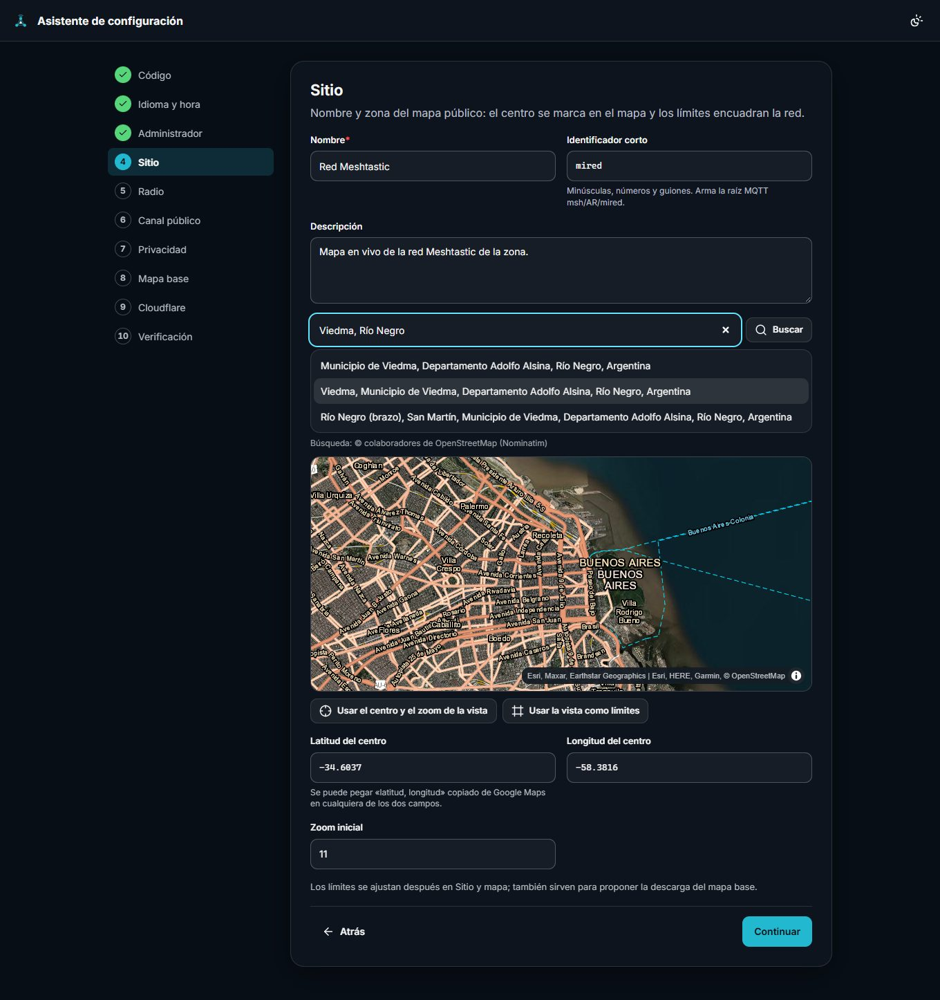

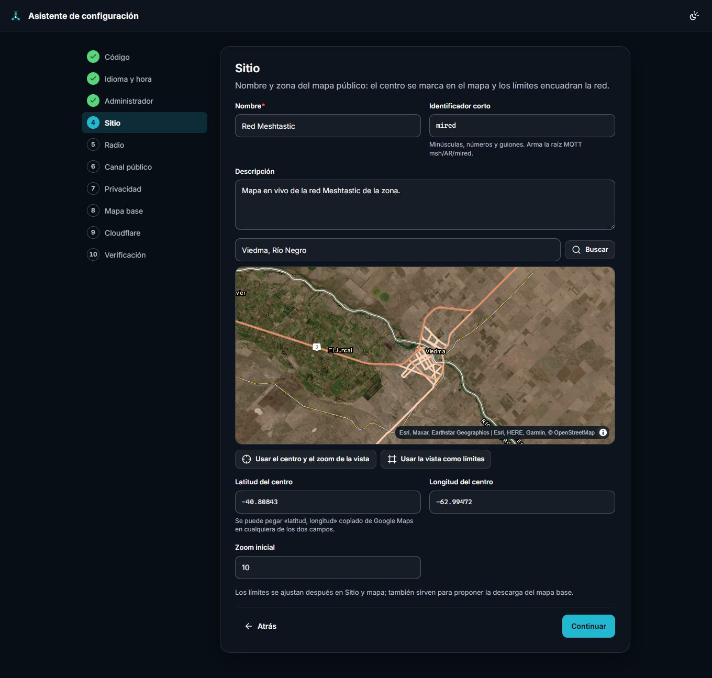

Sobre la imagen satelital se ven los nombres de las ciudades y las rutas, para ubicarse más fácil.

### 5.5 Radio

Cómo llegan los paquetes a meshbox. La forma más simple es **USB**: el nodo enchufado a la Pi con un cable de datos. Si hay un nodo enchufado, el asistente lo detecta y deja USB activado. La alternativa es un nodo con WiFi en otro lugar de la casa que publica por **MQTT** en el Mosquitto de la Pi (ver [6.2](#62-por-wifi-con-mqtt)). Se pueden usar los dos.

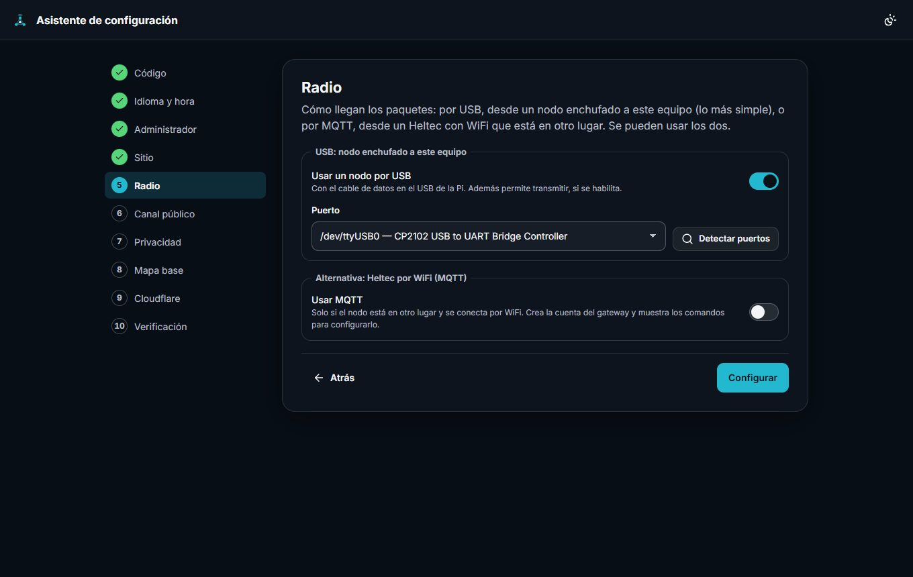

Al tocar **Configurar**, el asistente crea la conexión. **Probar la conexión** confirma que el nodo responde y muestra sus datos:

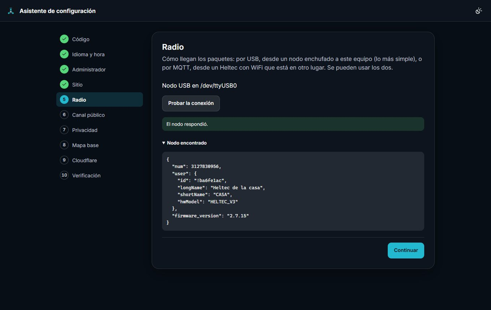

### 5.6 Canal público

El canal de la red de la zona, el que se muestra en el sitio. Tiene que coincidir con el que usan los nodos:

| Preset del nodo | Nombre del canal |
|---|---|
| LONG_FAST (de fábrica) | `LongFast` |
| MEDIUM_FAST | `MediumFast` |
| SHORT_FAST | `ShortFast` |
| LONG_SLOW, MEDIUM_SLOW, SHORT_SLOW | `LongSlow`, `MediumSlow`, `ShortSlow` |

La clave por defecto de Meshtastic es `AQ==`. Los canales privados (con otra clave) se agregan después en **Canales** y nunca se muestran en el sitio.

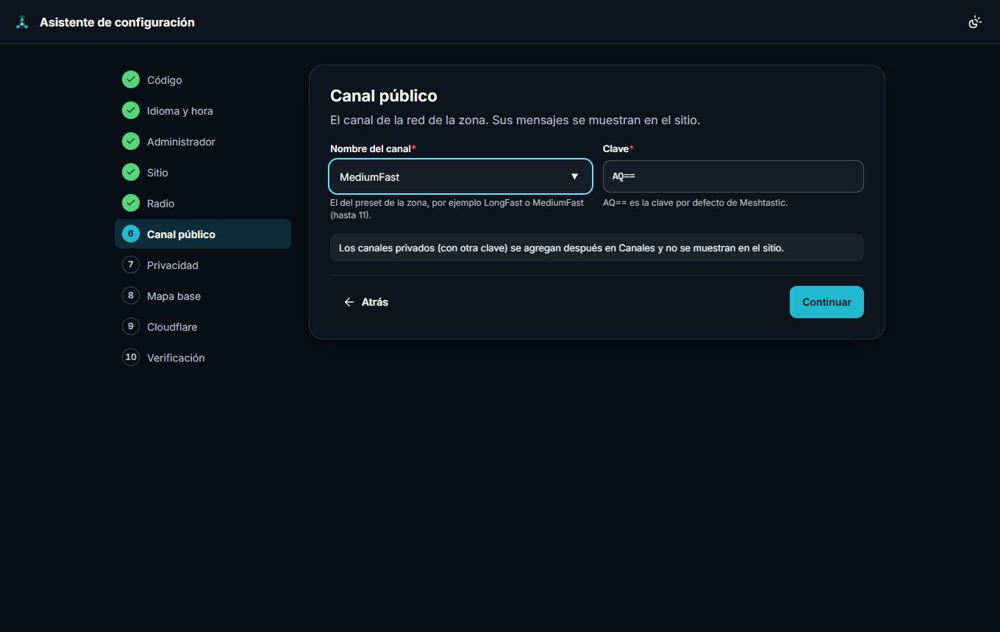

### 5.7 Privacidad

- **Ignorar los nodos que llegan solo por MQTT**: deja afuera los nodos de otras redes que llegan por servidores MQTT públicos y no por radio.
- **Precisión de las posiciones**: tal como las manda cada nodo, o redondeadas para todos.
- **Aviso del sitio**: un texto opcional que se suma a la página de privacidad.

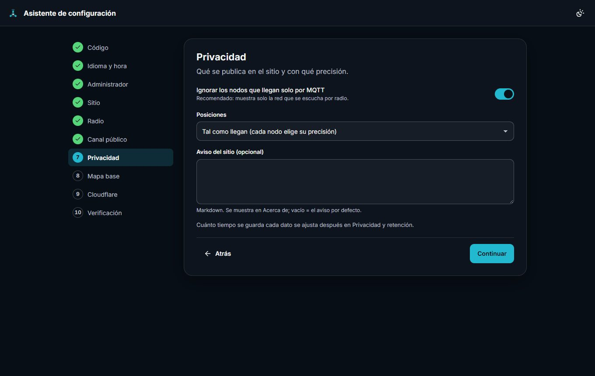

### 5.8 Mapa base

El mapa base es la cartografía de la zona (calles, rutas, nombres) guardada en la Pi. Con él, el sitio ofrece las capas **Claro** y **Oscuro** y el mapa se ve aunque no haya internet; sin él solo está la capa satelital, que necesita internet.

1. Buscar la ciudad o mover el mapa hasta encuadrar la zona de la red.
2. Tocar **Usar la vista como caja**.
3. Elegir el **zoom máximo**: 14 alcanza para ver calles; cada nivel más casi cuadruplica el tamaño.
4. Tocar **Descargar extracto**. La descarga sigue sola en segundo plano.

Como referencia, una ciudad mediana con sus alrededores a zoom 14 ocupa alrededor de 1,5 MB. El límite es una caja de 25 grados cuadrados (unos 5° × 5°).

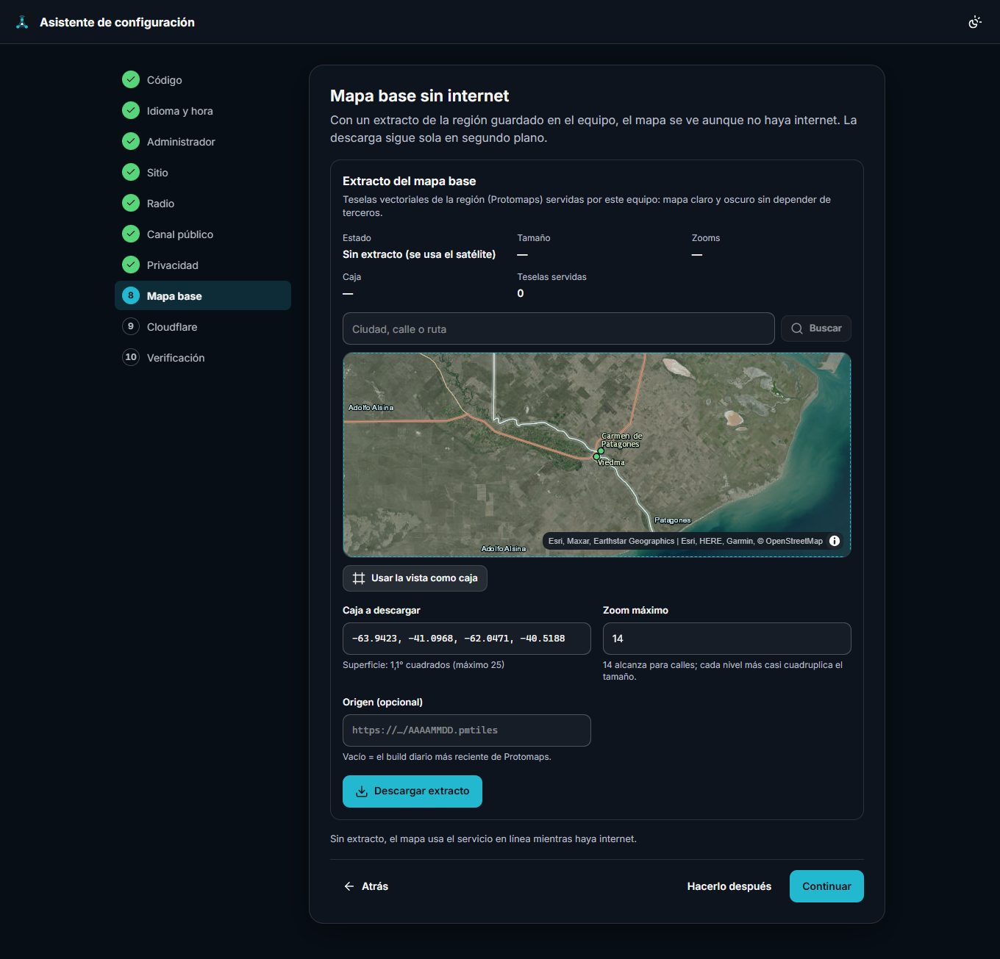

Se puede dejar para después: el mismo formulario está en **Sitio y mapa → Extracto del mapa base**.

### 5.9 Cloudflare

Publicar el sitio en internet es opcional y se puede hacer en cualquier momento desde el panel. Está explicado en [9. Publicar en internet](#9-publicar-en-internet).

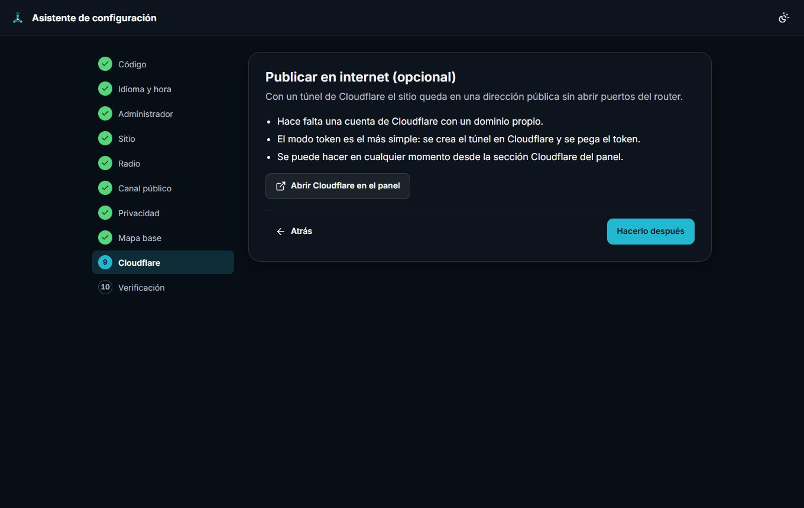

### 5.10 Verificación

El asistente comprueba que lleguen paquetes, que la conexión con la radio funcione, que haya canal público y que el sitio responda. Se actualiza solo. Si todavía no llegó ningún paquete se puede terminar igual: un nodo recién configurado puede tardar unos minutos.

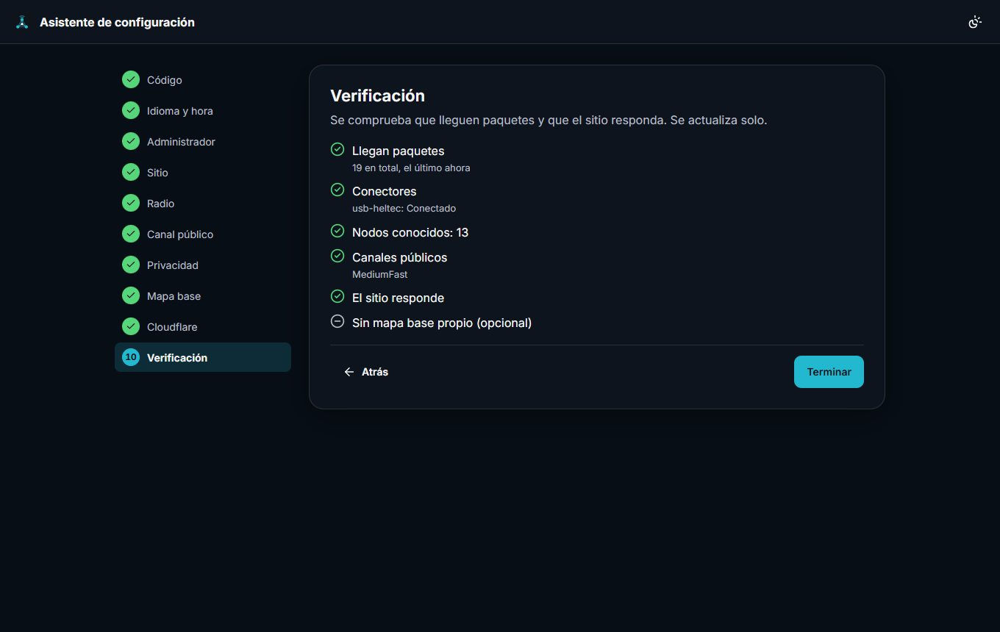

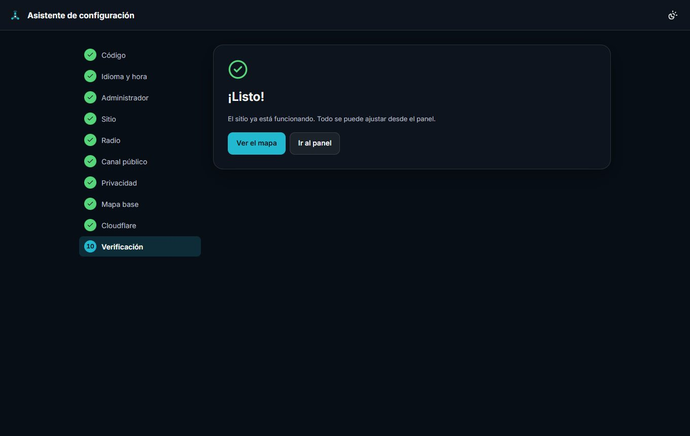

## 6. Conectar la radio

### 6.1 Por USB

Es la forma recomendada: no depende del WiFi y permite usar el **Cliente Meshtastic** del panel (estado, mensajes, configuración y batería de la placa).

- En la Pi Zero 2 W, el cable va en el micro-USB marcado **USB**, no en el de **PWR**.
- El cable tiene que ser de datos. Si **Detectar puertos** no encuentra nada, probar con otro cable.
- El nodo conserva su rol, su potencia y sus canales: meshbox solo escucha y, si se habilita la transmisión, manda lo que se le pide desde el panel.

### 6.2 Por WiFi con MQTT

Para un nodo que está en otro lugar (por ejemplo en el techo, con un panel solar) y llega a la red WiFi de la casa. meshbox trae su propio servidor MQTT, Mosquitto, ya instalado y configurado: no hace falta ningún servicio externo.

1. En el panel, **Broker MQTT → Crear cuenta**, propósito **Gateway**, con un nombre como `techo`. La cuenta queda como `gw-techo`.

   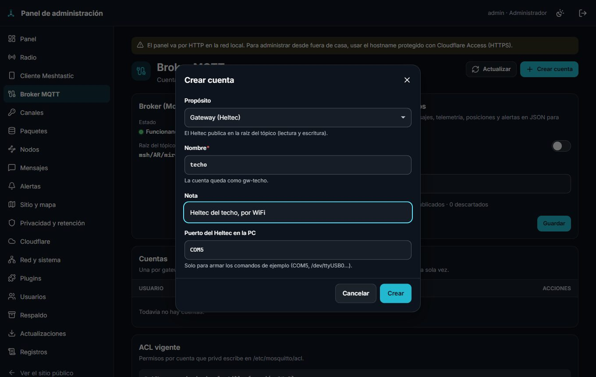

2. El panel genera la contraseña y la muestra **una sola vez**, junto con los comandos listos para configurar el nodo con la [CLI de Meshtastic](https://meshtastic.org/docs/software/python/cli/) desde una computadora con el nodo conectado por USB:

   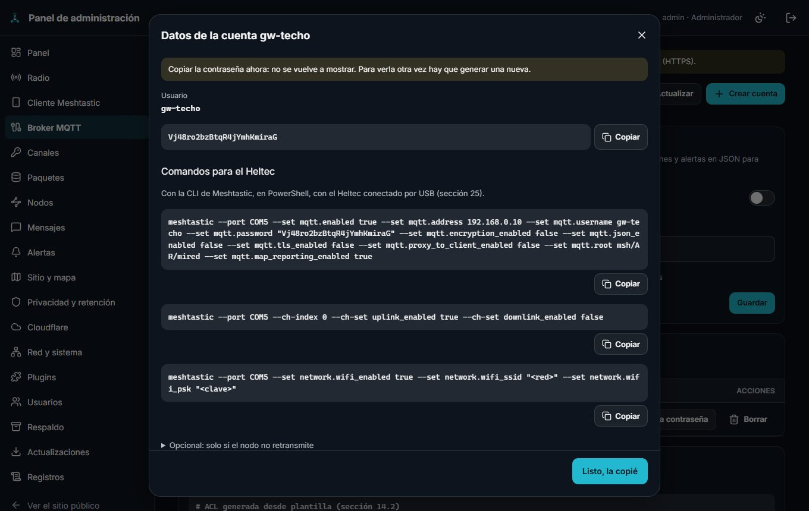

3. Copiar y ejecutar los comandos en orden. El tercero conecta el nodo al WiFi (reemplazar `<red>` y `<clave>`). Cada comando reinicia el nodo.

Los comandos ya traen la **IP de la Pi** como dirección del broker. Tiene que ser la IP y no un nombre: el firmware solo sube los paquetes de todos los nodos cuando el broker está en una IP privada. Si la Pi cambia de IP, hay que repetir el primer comando con la nueva; conviene reservarle una IP fija en el router.

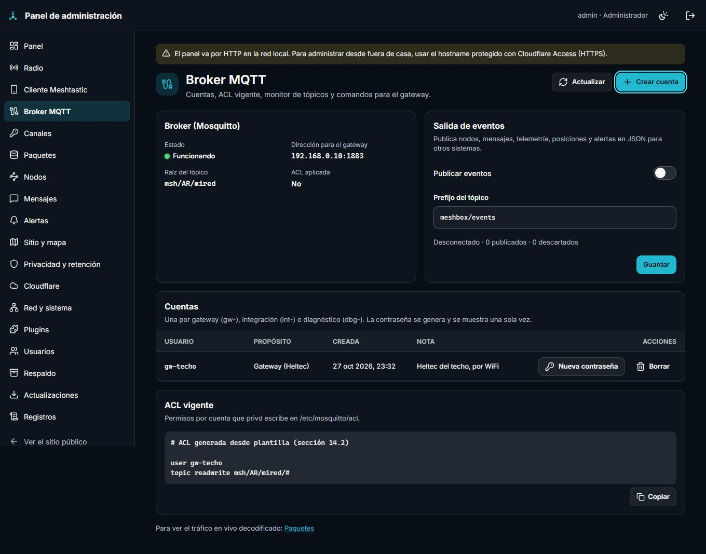

La guía completa del gateway, con el porqué de cada ajuste, está en [`heltec.md`](heltec.md).

### 6.3 Por WiFi con TCP

Un nodo con WiFi también se puede conectar a su API de red (puerto 4403) desde **Radio → Agregar conector → TCP**. Funciona como USB, incluido el Cliente Meshtastic, pero ocupa la conexión de red del nodo: mientras meshbox está conectado, la app del celular solo puede entrar por Bluetooth.

## 7. Sitio público

### 7.1 Mapa

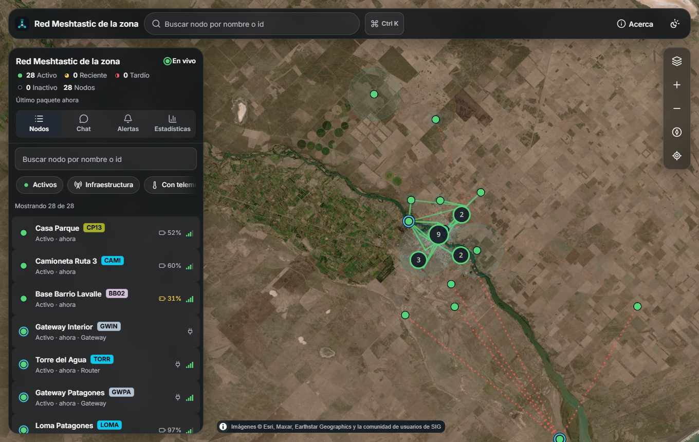

- **Panel izquierdo**: resumen de la red (nodos activos, recientes, tardíos e inactivos), pestañas Nodos, Chat, Alertas y Estadísticas, buscador y filtros (Activos, Infraestructura, Con telemetría).
- **Nodos**: cada uno con su color, que es el mismo en el mapa, en la lista y en el chat. El relleno del círculo indica qué tan reciente es: lleno activo, tres cuartos reciente, medio tardío, vacío inactivo. Los nodos de infraestructura (routers y repetidores) llevan un anillo.
- **Enlaces**: las líneas entre nodos según la señal con que se escuchan (verde buena, amarilla regular, punteada roja débil).
- **Actividad en vivo**: cada paquete que llega se ve como un pulso sobre el nodo que lo mandó.
- **Buscador**: por nombre o identificador. Con `Ctrl K` se abre desde cualquier parte.

### 7.2 Capas

El botón de capas, arriba a la derecha, elige el mapa base (Oscuro, Claro o Satélite) y las capas de datos. Claro y Oscuro aparecen cuando está descargado el mapa base (ver [5.8](#58-mapa-base)).

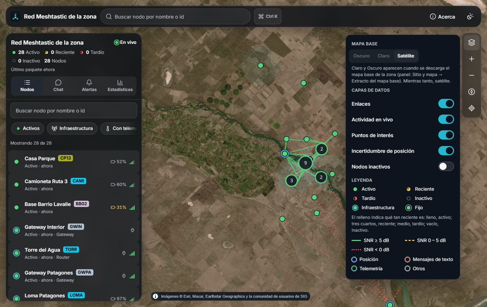

### 7.3 Ficha de un nodo

Al tocar un nodo se abre su ficha: modelo, rol, batería, señal, última vez que se escuchó, posición con su precisión, historial de posiciones y gráficos de telemetría. En los gráficos, arrastrar sobre una parte la acerca y doble clic vuelve a todo. El enlace de la ficha (`/n/!id`) se puede compartir y abre el mapa centrado en ese nodo.

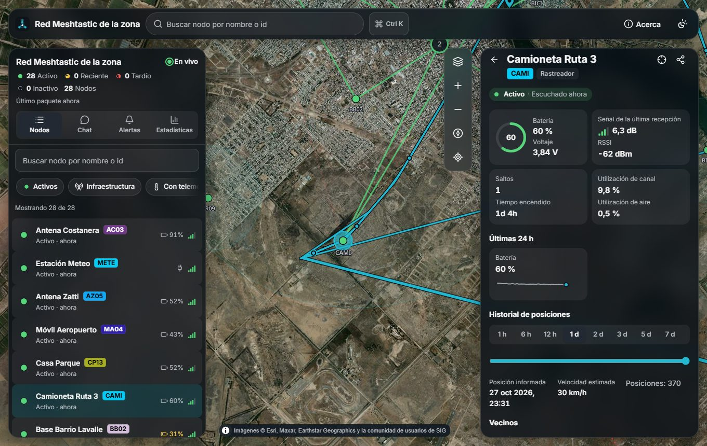

### 7.4 Chat, alertas y estadísticas

- **Chat**: los mensajes del canal público, con su hora, separados por día. El sitio es de solo lectura: los mensajes llegan por radio.
- **Alertas**: avisos de SOS y los que configure quien administra. Un SOS aparece además como cartel en todo el sitio y, si se aceptan, como notificación en el celular.
- **Estadísticas**: nodos activos, paquetes por hora, uso del canal y otros indicadores de la red.

<p>
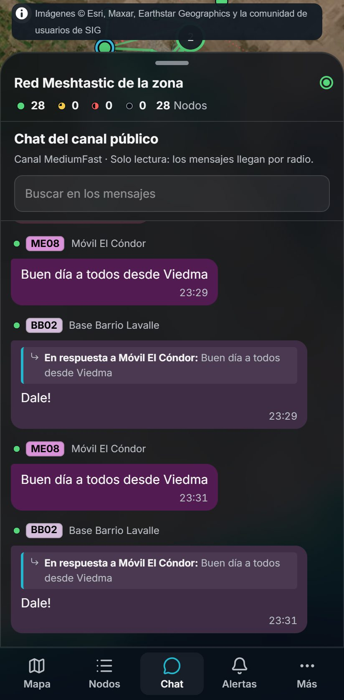
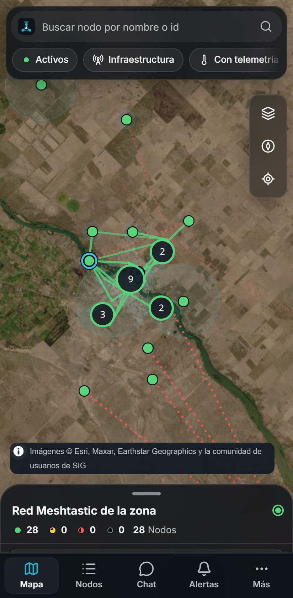
</p>

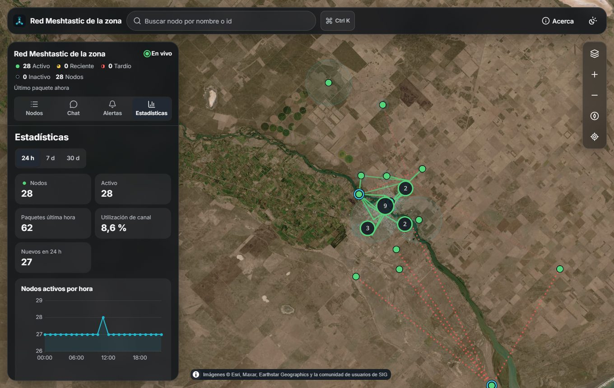

### 7.5 En el celular

En el celular el sitio se adapta: el mapa ocupa la pantalla y el panel sube desde abajo. Desde el menú del navegador, **Agregar a la pantalla de inicio** (o **Instalar aplicación**) lo deja como una aplicación más, que abre aunque no haya conexión con los últimos datos guardados.

## 8. Panel de administración

El panel está en `http://<dirección de la Pi>/admin` y solo responde en la red local, salvo que se publique aparte (ver [9.2](#92-panel-desde-afuera)). Hay dos roles: **administrador** (todo) y **operador** (el día a día: moderar nodos y mensajes, y consultar paquetes y registros).

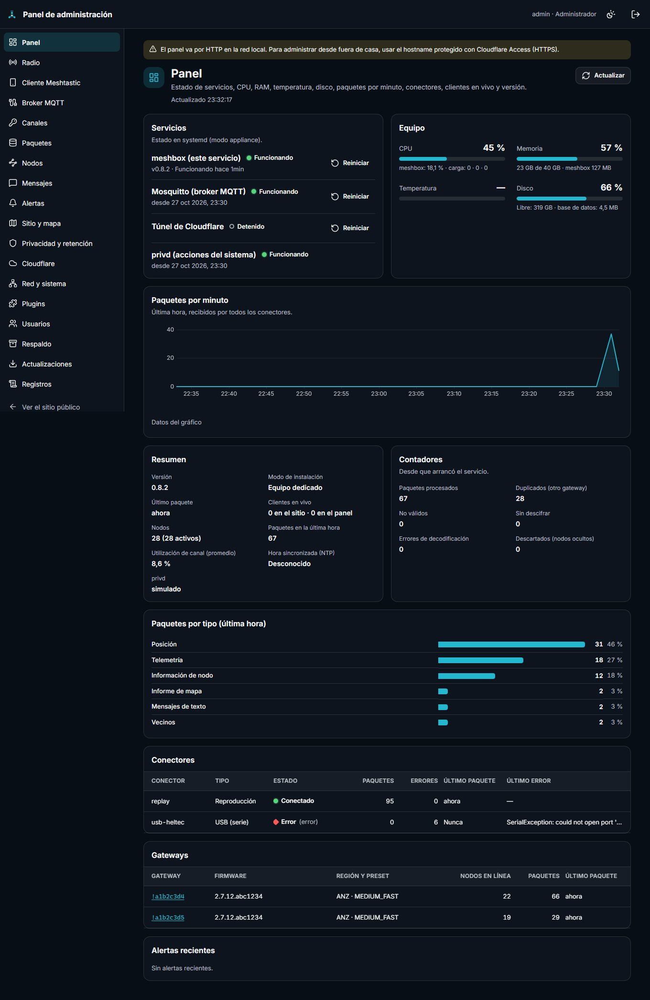

| Sección | Para qué sirve |
|---|---|
| Panel | Estado de los servicios, CPU, memoria, temperatura, disco, paquetes por minuto y alertas recientes. |
| Radio | Las conexiones con la radio (USB, TCP, MQTT): alta, prueba, reinicio, contadores y grabación de paquetes a un archivo. |
| Cliente Meshtastic | La placa conectada por USB o TCP como en la app: estado, batería, mensajes, nodos, canales y configuración, y la administración remota de otros nodos propios. |
| Broker MQTT | Cuentas de Mosquitto, permisos, comandos para el gateway y salida de eventos para otros sistemas. |
| Canales | Canales y claves, y cuáles se publican. |
| Paquetes | Todo lo que llega, en vivo o desde la base, con filtros y el detalle decodificado de cada paquete. |
| Nodos | Tabla completa: ocultar un nodo a pedido de su dueño, marcarlo como fijo, notas, borrar su historial. |
| Mensajes | Ocultar del sitio un mensaje del canal público. |
| Alertas | Reglas (palabra clave, batería baja, nodo caído o nuevo, gateway sin paquetes) y por dónde avisar: notificación web, Telegram, webhook o MQTT. |
| Sitio y mapa | Nombre, logo, color, capa por defecto, centro y límites, umbrales de estado y extracto del mapa base. |
| Privacidad y retención | Precisión de posiciones, nodos solo por MQTT y cuánto tiempo se guarda cada cosa. |
| Cloudflare | Publicación en internet y panel desde afuera. |
| Red y sistema | WiFi, IP, hora, nombre del equipo; reiniciar y apagar. |
| Plugins | Focos de calor de la NASA, estación meteorológica, puente de eventos hacia otros sistemas. |
| Usuarios | Altas, roles, contraseñas, sesiones activas y auditoría. |
| Respaldo | Respaldo diario automático, respaldos a mano, restaurar, exportar e importar la configuración. |
| Actualizaciones | Versiones disponibles, instalar y volver a la anterior. |
| Registros | Los registros de meshbox, Mosquitto, Cloudflare y el servicio del sistema, en vivo. |
| Transmisión | Mandar texto al canal o un traceroute por la placa (desactivado de fábrica). |

### 8.1 Cliente Meshtastic

Con la placa conectada por USB o TCP, esta sección hace lo que la app del celular sin tener que subir al techo.

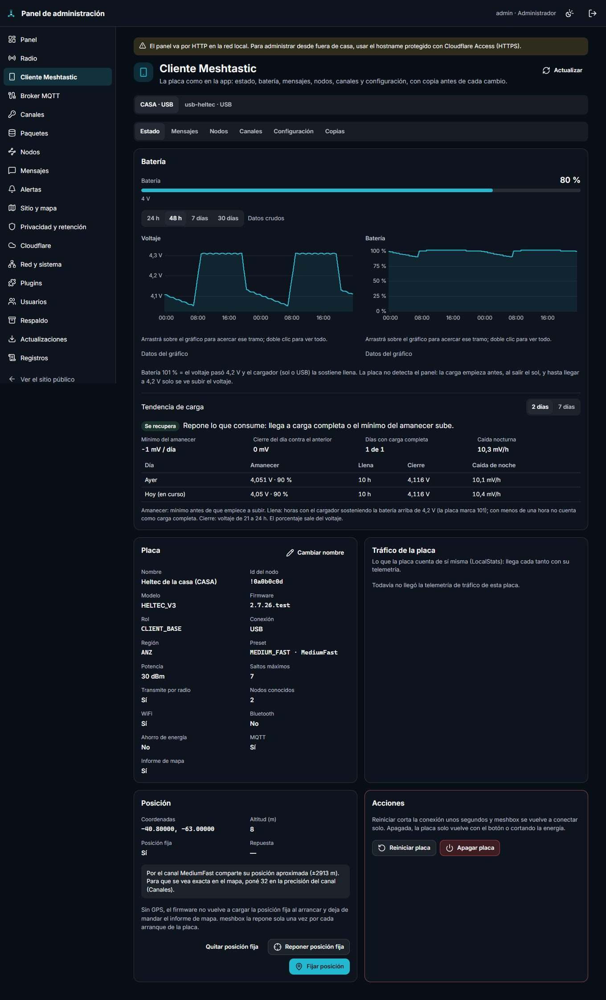

- **Batería**: voltaje y carga en dos gráficos, de 24 horas a 30 días. La placa marca **101 %** cuando el voltaje pasa 4,2 V y el cargador la sostiene llena; en ese tramo el voltaje es el que fija el cargador y no el de la batería en reposo.
- **Tendencia de carga**, a 2 y 7 días, pensada para nodos con panel solar. Mira el mínimo antes del amanecer de cada día, las horas con la batería llena y la caída nocturna, y da uno de tres resultados:
  - **Se recupera**: el panel repone lo que se consume.
  - **Estable**: repone justo, con poco margen para días nublados.
  - **Déficit**: el mínimo baja día tras día, y la tendencia calcula en cuántos días llega a 3,5 V, donde la placa se reinicia.
- **Placa**: nombre (se cambia con **Cambiar nombre**), modelo, firmware, rol, región, preset, potencia.
- **Posición**: **Fijar posición** abre un mapa satelital con buscador de lugares; se mueve el mapa bajo la marca o se pegan las coordenadas. El panel avisa si el canal comparte la posición aproximada o exacta.
- **Acciones**: reiniciar o apagar la placa.

Las demás pestañas:

- **Mensajes**: los de todos los canales y los directos, guardados en la Pi, con acuse de recibo. Se ven igual desde cualquier dispositivo y quedan después de reiniciar. Tocar el nombre de quien escribió abre su ficha (modelo, rol, señal, saltos, batería) y desde ahí un **Mensaje directo**, aunque nunca te haya escrito.
- **Nodos**: los que conoce la placa.
- **Canales** y **Configuración**: editar con una copia automática antes de cada cambio y doble confirmación para lo delicado.
- **Copias**: las copias de configuración, para restaurar una.

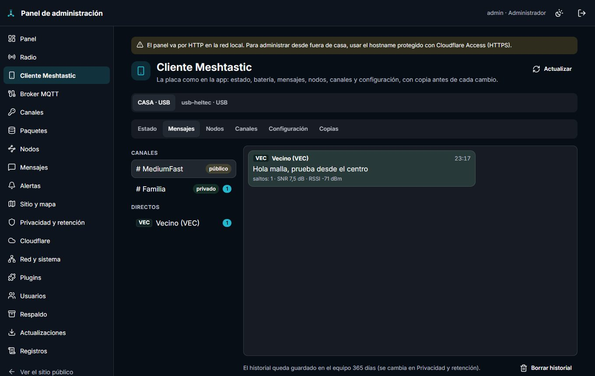

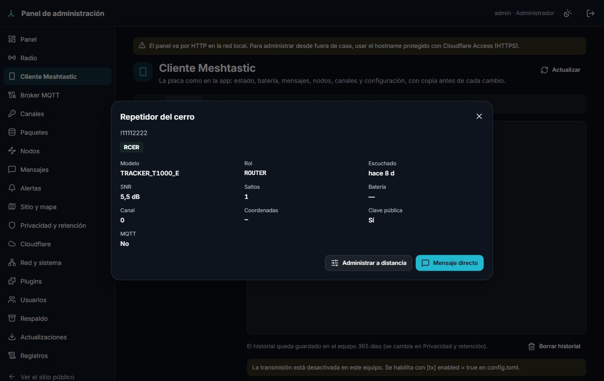

#### Administrar otros nodos a distancia

La pestaña **Remoto** administra por la malla otros nodos propios, como la app de Meshtastic: un repetidor en una torre o un techo se configura y se reinicia sin ir hasta él. Hace falta firmware 2.5 o más nuevo en los dos equipos.

Preparación, una sola vez por nodo y mejor antes de llevarlo a su lugar:

1. En **Remoto**, copiar la **clave pública de esta placa**.
2. Conectarse al nodo con la app de Meshtastic (Bluetooth o USB) y en **Configuración → Seguridad** pegarla en **Clave de administración**. El nodo admite hasta tres claves, así que se puede dejar también la del celular.
3. Volver al panel, elegir el nodo y tocar **Probar conexión**. Si responde «Acepta administración», está listo.

Después, desde **Remoto** (o con **Administrar a distancia** en Nodos o en la ficha de un nodo):

- **Configuración del nodo**: se elige una sección y se toca **Leer del nodo**; se leen de a una para no ocupar el aire. Al guardar, meshbox guarda la sección leída en las copias de la Pi, manda el cambio y vuelve a leer para verificar. Si el cambio reinicia el nodo, queda «sin verificar» y conviene leerla de nuevo en un minuto.
- **Cambiar nombre**, **Fijar posición** y **Reiniciar nodo**.

Cada pedido viaja por radio: con varios saltos la respuesta puede tardar hasta un minuto. Hay cosas que a distancia no se tocan, porque un error deja el nodo fuera de la red y obliga a ir hasta él: la sección **Seguridad** y los parámetros de radio de **LoRa** (región, preset, frecuencia, canal y transmisión). La potencia, los saltos y el resto sí. Los cambios delicados (rol, WiFi, Bluetooth, MQTT) piden la misma doble confirmación que en la placa local y, con el panel publicado en internet, solo se hacen desde la red local.

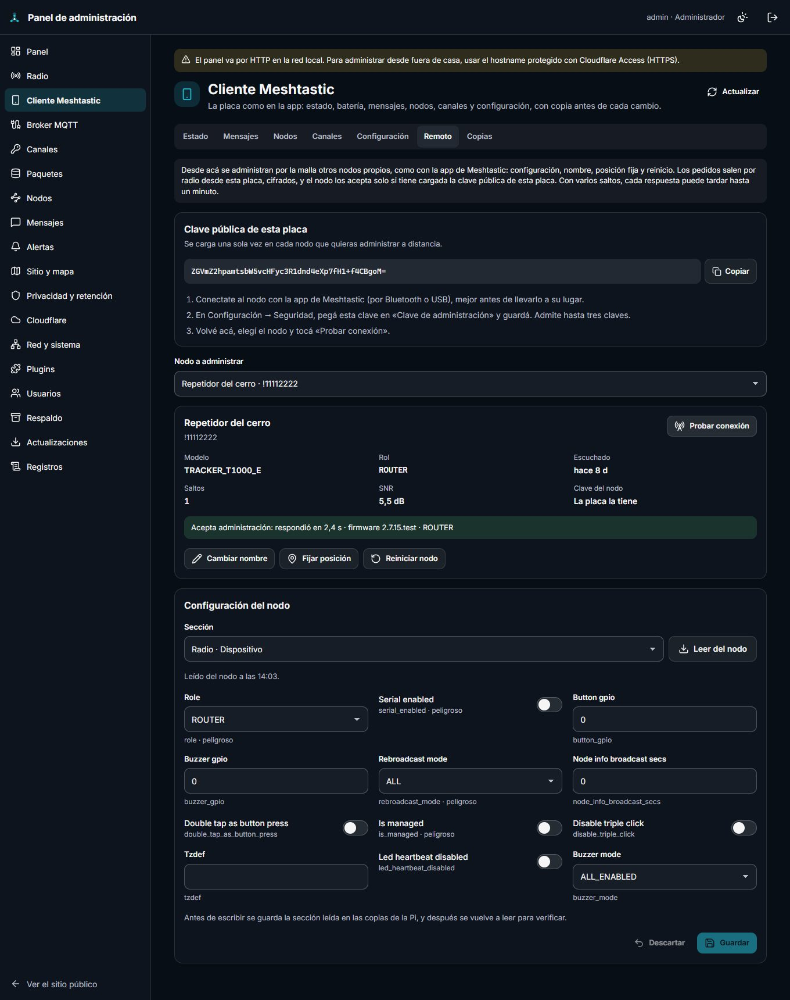

### 8.2 Canales

El canal público se carga en el asistente. Acá se agregan los privados para que meshbox pueda leerlos; nunca se muestran en el sitio. Las claves no se vuelven a mostrar una vez guardadas.

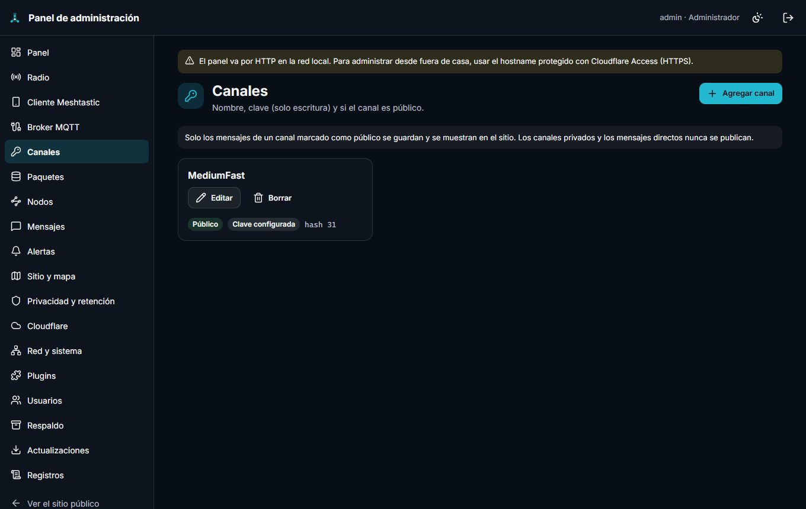

### 8.3 Nodos

La tabla de todos los nodos, incluidos los ocultos. Si el dueño de un nodo pide que no aparezca, se oculta desde acá y se puede borrar su historial.

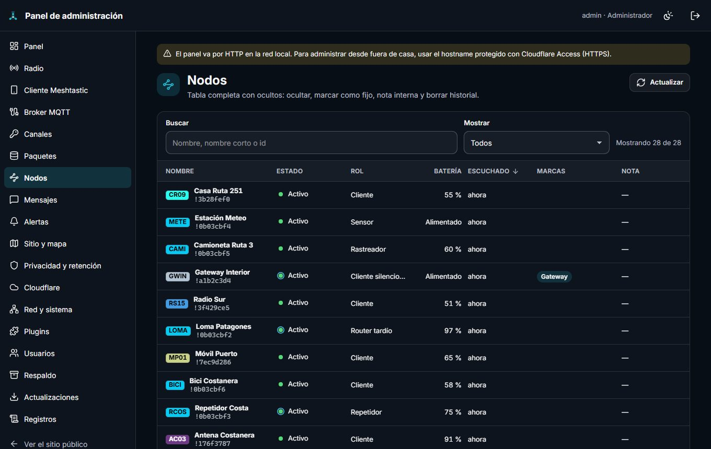

### 8.4 Sitio y mapa

Nombre, descripción, logo, color de acento, capa por defecto, centro y límites (con el mismo buscador y el pegado de coordenadas del asistente), umbrales para considerar a un nodo reciente, tardío o inactivo, y el extracto del mapa base.

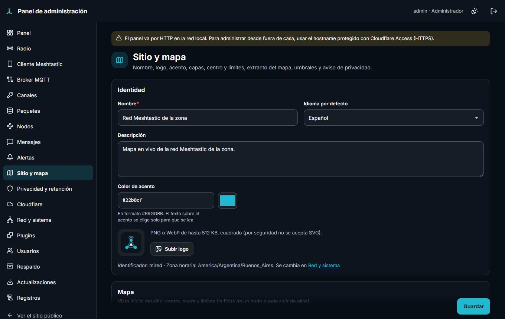

### 8.5 Privacidad y retención

Cuánto tiempo se guarda cada cosa (de fábrica: posiciones 90 días, mensajes 365 días) y con qué precisión se muestran las posiciones. Hay una purga inmediata para aplicar un cambio sin esperar.

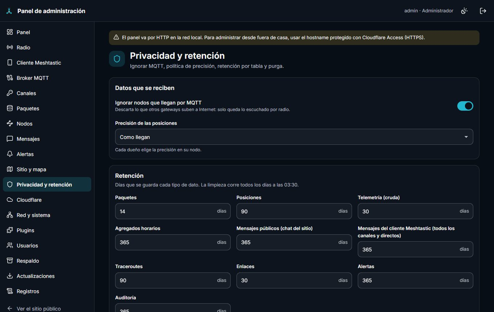

### 8.6 Usuarios

Altas y bajas, rol de cada usuario, cambio de contraseña, sesiones abiertas con cierre a distancia y la auditoría de cambios.

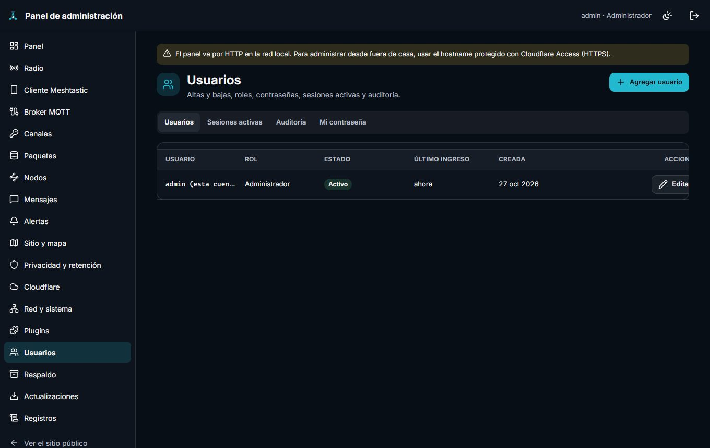

## 9. Publicar en internet

meshbox publica el sitio con un **túnel de Cloudflare**: la Pi abre una conexión hacia Cloudflare y no hace falta abrir puertos en el router ni tener IP fija. Hace falta una cuenta gratuita de Cloudflare y un dominio administrado ahí.

### 9.1 Sitio público

1. En Cloudflare: **Zero Trust → Networks → Tunnels → Create a tunnel**, tipo **Cloudflared**, con un nombre como `meshbox-mizona`.
2. Copiar el **token** del túnel (lo que sigue a `--token` en el comando que muestra Cloudflare).
3. En **Public Hostname**, agregar el nombre público (por ejemplo `mapa.midominio.com`) con el servicio `http://127.0.0.1:8081` en un equipo dedicado o `http://127.0.0.1:8091` en uno compartido. El panel muestra la dirección exacta.
4. En el panel de meshbox, **Cloudflare → Modo token**: pegar el token y el nombre público.
5. En la zona del dominio en Cloudflare, activar **SSL/TLS → Edge Certificates → Always Use HTTPS**.

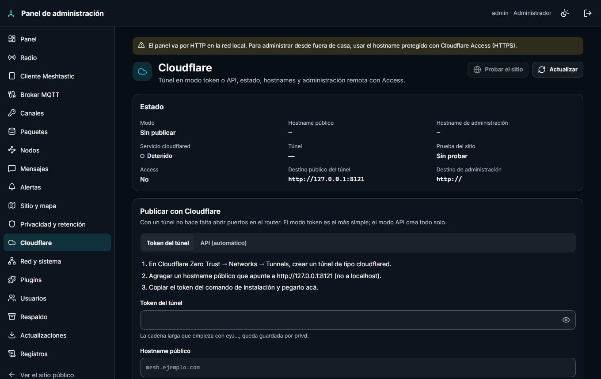

El túnel apunta solo al sitio público, que no tiene panel: `/admin` y `/setup` no existen en esa dirección.

### 9.2 Panel desde afuera

Para administrar fuera de casa se puede publicar el panel en otro nombre (por ejemplo `admin.midominio.com`), protegido con **Cloudflare Access** o con el usuario y la contraseña de meshbox y una regla de firewall de Cloudflare que limite los países. El detalle está en [`cloudflare.md`](cloudflare.md).

## 10. Mantenimiento

### 10.1 Actualizaciones

En **Actualizaciones** el panel muestra la versión instalada y las publicadas, con sus notas. **Instalar** baja el paquete, verifica la firma y lo instala; el sitio se corta un par de minutos. Si algo sale mal, **Volver a la anterior** deja la versión previa, con la base como estaba.

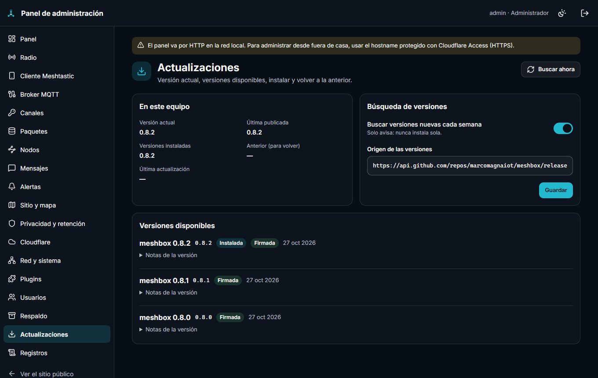

### 10.2 Respaldos

Todos los días se hace un respaldo automático de la base. Desde **Respaldo** se puede hacer uno a mano, descargarlo, restaurar uno (se verifica antes) y exportar la configuración para llevarla a otro equipo.

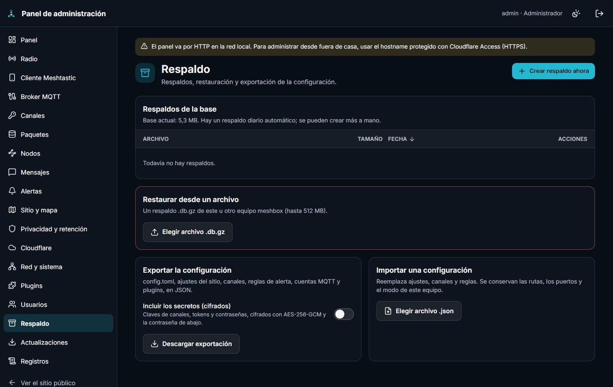

### 10.3 Reparar o reinstalar

Volver a correr el comando de instalación repara la instalación sin borrar datos, configuración ni cuentas. Para quitar meshbox por completo, los pasos están en [`instalacion.md`](instalacion.md#11-desinstalación-manual).

### 10.4 Comandos útiles

| Para | Comando |
|---|---|
| Ver los registros en vivo | `journalctl -u meshbox -f` |
| Reiniciar meshbox (reabre el asistente si no terminó) | `sudo systemctl restart meshbox` |
| Ver el código de configuración | `sudo grep setup_code /etc/meshbox/secrets.toml` |
| Cambiar la contraseña de un usuario | `sudo -u meshbox /opt/meshbox/current/.venv/bin/python -m meshbox user passwd admin --config /etc/meshbox/config.toml` |
| Estado de los servicios | `systemctl status meshbox mosquitto meshbox-cloudflared` |

## 11. Problemas frecuentes

| Qué pasa | Qué hacer |
|---|---|
| La dirección de la Pi abre el mapa y no el asistente | El asistente está en `/setup`, por ejemplo `http://meshbox.local/setup`. El sitio muestra un botón **Ir al asistente** mientras no haya usuarios. |
| El asistente dice que se cerró | Queda abierto 60 minutos desde que arranca el servicio. Se vuelve a abrir con `sudo systemctl restart meshbox`. |
| No aparece `meshbox.local` | Algunos celulares Android no resuelven `.local`. Usar la IP de la Pi, que muestra el router o el comando `hostname -I`. |
| **Detectar puertos** no encuentra el nodo | Cable de datos (no solo de carga), conector **USB** y no **PWR** en la Zero 2 W, nodo encendido. |
| El nodo por MQTT no se conecta | Que `mqtt.address` sea la IP de la Pi y no un nombre, que la contraseña sea la que dio el panel y que el nodo esté en la misma red. En **Broker MQTT** se puede rotar la contraseña y volver a cargarla. |
| No llegan paquetes | En **Radio**, el estado y el último error de cada conexión. Que el canal público y la región del nodo coincidan con los de la red. |
| Falla la descarga del mapa base | El panel muestra el motivo. Revisar la conexión a internet y, si la caja es muy grande, achicarla o bajar el zoom máximo. Desde la versión 0.8.2 la descarga ya no falla con routers que rechazan ciertas consultas de nombres. |
| Claro y Oscuro aparecen bloqueados | Falta descargar el mapa base (ver [5.8](#58-mapa-base)). |
| Un nodo propio no aparece en el mapa | El canal tiene que compartir la posición. En la app del nodo, en el canal primario, activar la posición; con precisión 32 se ve exacta. Un nodo sin GPS necesita posición fija. |
| **Remoto**: «El nodo no acepta administración de esta placa» | Falta la clave pública de la placa en el nodo, o se cargó otra. Repetir los pasos de [8.1](#81-cliente-meshtastic) con la app conectada al nodo. |
| **Remoto**: «Esta placa no tiene la clave pública del nodo» | La placa todavía no recibió la información del nodo (NodeInfo). Esperar a que el nodo la anuncie, o reiniciarlo desde la app. |
| **Remoto**: «El nodo no respondió» | Con varios saltos puede tardar: volver a intentar. Si sigue igual, revisar en **Nodos** cuándo se lo escuchó por última vez y con cuántos saltos. |
| Olvidé la contraseña del panel | Otro administrador la cambia desde **Usuarios**. Si no hay otro, con el comando de [10.4](#104-comandos-útiles). |
| "El puerto 80 está ocupado" al instalar | Otro servicio usa el puerto: instalar en modo compartido (`--shared`). |

## 12. Glosario

| Término | Significado |
|---|---|
| Nodo | Cada radio Meshtastic de la red. |
| Gateway | El nodo que le pasa a meshbox lo que escucha, por USB, TCP o MQTT. |
| Canal | Un grupo de conversación con su nombre y su clave. El público usa la clave por defecto; los privados, una propia. |
| Preset | La combinación de velocidad y alcance de la radio (LongFast, MediumFast…). Todos los nodos de una red usan el mismo. |
| MQTT | Protocolo para pasar mensajes entre equipos. Los nodos con WiFi lo usan para mandar paquetes a un servidor. |
| Mosquitto | El servidor MQTT que trae meshbox. |
| Extracto o mapa base | La cartografía de la zona guardada en la Pi, en formato PMTiles de Protomaps. |
| Túnel de Cloudflare | La conexión que abre la Pi hacia Cloudflare para publicar el sitio sin abrir puertos. |
| SNR | Relación señal/ruido con que se escucha un nodo. Más alta es mejor. |
| 101 % | Lo que informa una placa cuando el cargador la sostiene llena. |

## Más información

- [`instalacion.md`](instalacion.md): referencia técnica del instalador, la imagen de SD y la disposición en disco.
- [`heltec.md`](heltec.md): configuración del nodo como gateway.
- [`cloudflare.md`](cloudflare.md): publicación con Cloudflare y administración remota.
- [`privacidad.md`](privacidad.md): qué se guarda, por cuánto tiempo y cómo pedir la baja.
- [`admin.md`](admin.md): referencia breve de cada sección del panel.
- Problemas o ideas: [issues en GitHub](https://github.com/marcomagnaiot/meshbox/issues).
